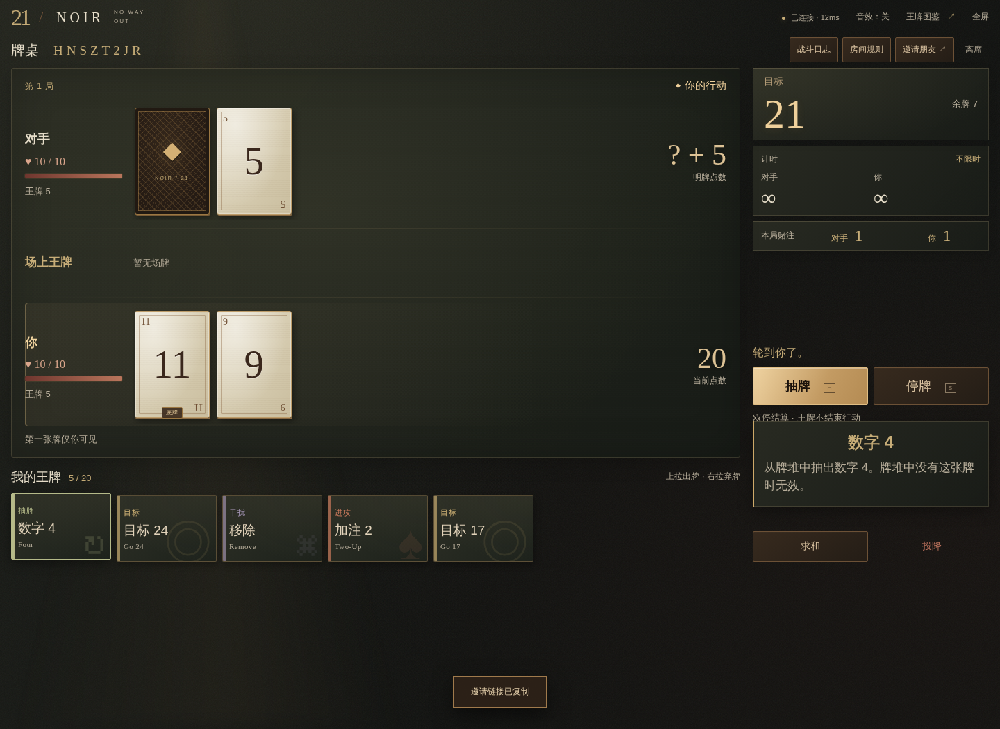
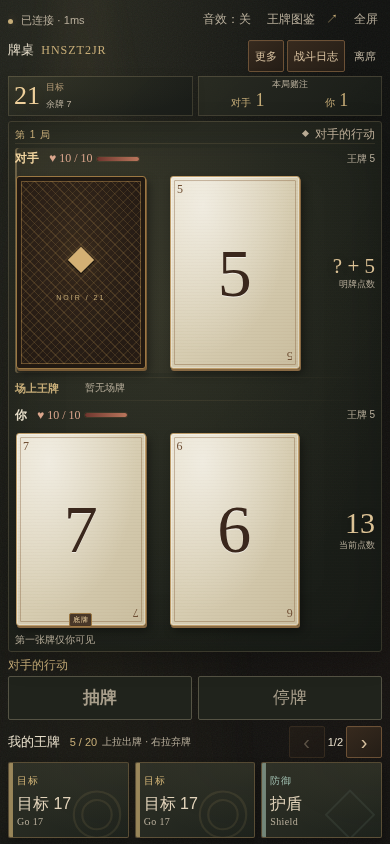

<h1 align="center">RE7 / 21 — NOIR Web</h1>

<p align="center">
  <strong>浏览器里的 21 点对决，保留原版 48 张王牌。</strong><br>
  用房间码约朋友打一场，或选一个 AI 对手。打开网页就能玩，无需注册。
</p>

<p align="center">
  <a href="https://game.404elf.dev/re7/"><strong>在线试玩 →</strong></a>
  · <a href="#快速开始">快速开始</a>
  · <a href="#自托管">自托管</a>
  · <a href="#参与贡献">参与贡献</a>
</p>

<p align="center">
  <a href="https://github.com/404elf/RE7_21_Noir_Web/actions/workflows/web.yml"></a>
  <a href="#从源码运行"></a>
  <a href="LICENSE"></a>
</p>

[](https://game.404elf.dev/re7/)

<details>
<summary>查看手机牌桌</summary>
<br>

</details>

## 快速开始

1. 打开[在线试玩](https://game.404elf.dev/re7/)，输入昵称。
2. **和朋友玩**：创建房间，把房间码或邀请链接发给对方。双方确认规则并准备即可开局。
3. **自己玩**：选择「人机对战」，挑选难度和打法后入座。人机也通过网站服务器运行。

抽牌或停牌可以点按钮，也可以用键盘 `H` / `S`。点选王牌查看效果，向上拖出牌，向右拖弃牌。在原标签页刷新，可以恢复仍有效的席位。

## 游戏特色

| 特色 | 玩法 |
| --- | --- |
| **48 张原版王牌** | 调整目标点数、改变赌注或交换牌张，让一手普通的 21 点有不同的解法。 |
| **双人房间与人机对战** | 邀朋友进行完整对局，支持断线重连和再战；也可挑战原版四档 AI 难度。 |
| **每桌独立规则** | 选择 8 套原版预设之一，或调整牌池、生命和计时。支持 `5+3` 等计时预设与规则 JSON 导入、导出。 |
| **适配手机** | 竖屏与横屏布局、触屏拖牌、可选音效；浏览器支持时可进入全屏。 |

Web 版复用桌面版的 Python 规则。FastAPI 负责房间、行动校验与计时，浏览器通过 WebSocket 同步牌局；前端使用 HTML、CSS 和 JavaScript，无需 Node.js 构建。

## 自托管

### Docker Compose

需要 Docker 和 Compose。默认仅监听本机，适合先试跑：

```sh
git clone https://github.com/404elf/RE7_21_Noir_Web.git
cd RE7_21_Noir_Web
docker compose -p noir-web up --build -d
```

打开 [http://127.0.0.1:8000](http://127.0.0.1:8000)。健康检查入口为 `/healthz`；停止服务用 `docker compose -p noir-web down`。

### 从源码运行

在仓库目录使用 **Python 3.12+** 创建虚拟环境：

```sh
python -m venv .venv-web
```

| 系统 | 激活命令 |
| --- | --- |
| macOS / Linux | `source .venv-web/bin/activate` |
| Windows PowerShell | `.\.venv-web\Scripts\Activate.ps1` |

```sh
python -m pip install -r requirements-web.txt
python -m uvicorn web.app:app --host 127.0.0.1 --port 8000 --workers 1 --ws-max-size 2048 --ws-max-queue 8
```

打开 [http://127.0.0.1:8000](http://127.0.0.1:8000)。Web 版不需要 Pygame 或数据库。测试双人对局时，请从首页新开第二个标签页，避免复制已有的席位凭证。

### 部署到子路径

将 [环境变量示例](deploy/noir.env.example) 复制为 `.env`，按自己的域名修改。以正式试玩地址为例：

```dotenv
NOIR_BASE_PATH=/re7
NOIR_ORIGIN=https://game.404elf.dev
```

反向代理须**保留 `/re7` 前缀并转发 WebSocket**。`NOIR_ORIGIN` 只填来源，不带路径。房间保存在内存中，请运行 **一个 worker、一个服务副本**；重启会清空当前房间。

- [完整运行、配置与部署指南](docs/WEB.md)
- [Nginx 子路径代理示例](deploy/nginx-re7.conf.example)
- [界面设计与取舍](docs/DESIGN.md)

## 参与贡献

欢迎[提交 Issue](https://github.com/404elf/RE7_21_Noir_Web/issues) 或 Pull Request。报告问题时请附上复现步骤、浏览器和设备；涉及计时或王牌时，也请注明房间配置。

在开发环境运行基础回归和双浏览器测试：

```sh
python -m pip install -r requirements-web-dev.txt
python -m playwright install chromium
python -m pytest tests -q
python tests/web_e2e.py
```

[GitHub Actions](https://github.com/404elf/RE7_21_Noir_Web/actions/workflows/web.yml) 另外验证子路径、界面、人机、延迟和 Docker 镜像。完整测试命令见 [Web 指南](docs/WEB.md#测试)。

## 来源与许可

这是 [RE7_21_Noir 桌面版](https://github.com/404elf/RE7_21_Noir) 的独立浏览器版本。共享规则的来源与同步方式见 [UPSTREAM.md](UPSTREAM.md)。代码以 [MIT 许可证](LICENSE) 发布。
